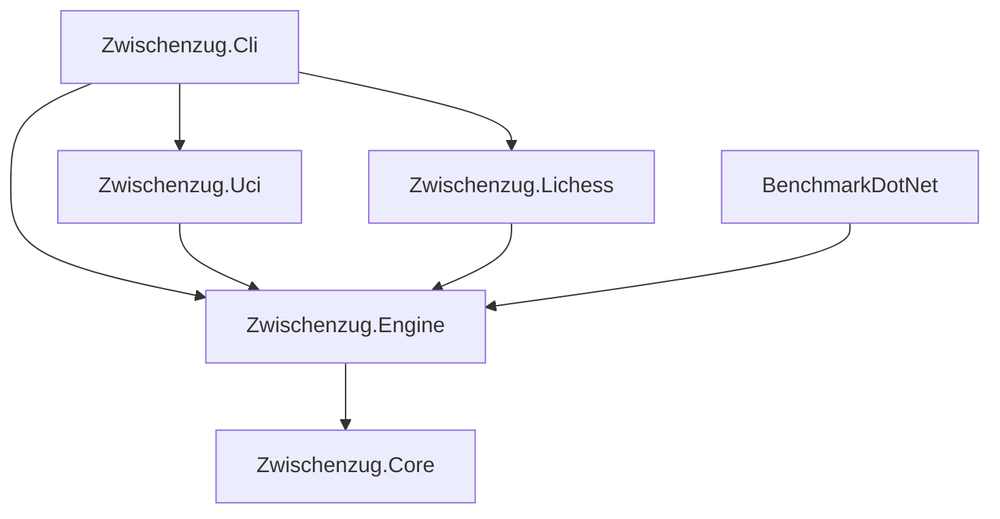

# Architecture

Zwischenzug is a .NET 10 chess engine with independent UCI and Lichess adapters. The CLI is the composition root. UCI searches can use configurable Lazy SMP; all projects target C# 14, invariant globalization and nullable reference types, with warnings treated as errors.

## Dependency flow

Adapters reference Engine only; Core types are available through the transitive project reference. No adapter references another adapter. Test projects reference their subject only. Core has no package dependencies.

## State ownership

- **Core**: packed moves, mailbox/bitboards, legal generation, FEN, normalized repetition keys, fixed undo/history storage and perft.
- **Engine**: tapered evaluation, legal static exchange evaluation, four-way transposition table and iterative PVS search. Lazy SMP creates an independent `Searcher` and history-preserving `Position` per worker; bucket reads/writes on the shared TT use stripe locks. The facade owns the root position and rejects state mutations until all workers are joined.
- **UCI**: pure typed parser, invariant formatter, atomic output and asynchronous search completion. `Threads` controls Lazy SMP; `MultiPV` emits distinct root lines; `UCI_ShowWDL` opts into Stockfish-model estimates; `Ponder` plus `go ponder`/`ponderhit` enables ponder clock transitions. Command mutations cancel and await the old search first; ready remains responsive. Stdout contains protocol lines only. Fatal search faults wake input and terminate visibly rather than inventing a move.
- **Lichess transport**: typed HttpClient, per-request bearer header, generated JSON metadata, streaming NDJSON and bounded reconnect. Bodies and headers never enter logs; redirects are disabled by the composition root.
- **Lichess bot**: accepted-challenge reservations plus bounded per-game sessions. Each game owns its engine. Snapshots retain initial FEN and identity; every actionable state rebuilds position from the complete authoritative move prefix. Superseded searches are canceled/awaited before a new position is installed. Ambiguous move delivery refreshes the snapshot before any retry.
- **CLI**: Host configuration, DI, stderr logging and System.CommandLine commands. Manual typed configuration avoids reflection-based options binding. Tokens come from configuration/environment/user-secrets, never command arguments.

Challenge IDs become game IDs in Lichess: [Challenge.gameId](https://github.com/lichess-org/lila/blob/master/modules/challenge/src/main/Challenge.scala) converts the challenge ID and [ChallengeJoiner](https://github.com/lichess-org/lila/blob/master/modules/challenge/src/main/ChallengeJoiner.scala) creates the game with it. Reservations are released by exact identity, never by arbitrary insertion order. Event models support both documented gameId and id fields.

## Evaluation models

Material/PST evaluation remains the default. Set `Nnue__ModelPath` to a packaged model path to select the Chess768 evaluator at CLI startup; AVX2 feature updates are used when supported, with a portable scalar fallback. A configured but invalid model fails startup instead of falling back silently. Create the package from a compatible Bullet `quantised.bin` with `dotnet run --project src/Zwischenzug.Cli -c Release -- nnue pack <bullet-model> <output-model>`.

The project model format has a 72-byte little-endian header (`ZNNUE768`, version 1, fixed Chess768/128-hidden quantization contract, payload length, SHA-256) followed by the pinned Bullet quantized layout. The evaluator uses side-to-move perspective features and per-search-ply accumulators updated from board-square differences. Each evaluator instance is mutable and must not be shared by concurrent searches. The output path uses scalar 64-bit accumulation; no trained model is bundled, and the bounded trainer smoke is not a strength result.

## Verification and measurement

MSTest runs on Microsoft.Testing.Platform. Core coverage uses the six CPW perft positions, state/key restoration and special moves. Engine coverage includes twenty exact mate-distance positions, draws, bounded time/nodes, deterministic repeated searches, TT replacement and SEE pins, threefold history in parallel workers, cancellation/join, MultiPV legality, and ponder timing. UCI transcript tests cover effective Threads, MultiPV/WDL reports, ponderhit release, and fatal-search handling. Lichess coverage exercises representative NDJSON through fake HTTP streams, including dropped connections, 429 and ambiguous move reconciliation.

The CLI benchmark clears state per position over a committed 25-position suite. Its default-depth node count is a behavioral regression signature, not a strength rating. BenchmarkDotNet reports move-generation throughput, perft/search NPS, allocations and measured TT hit percentage. A ten-game external match checks protocol safety; separate SPRT runs test strength changes.

## Limits and decisions

Position supports 1,024 accumulated plies; search supports 94. UCI `Threads` supports 1–128 workers with independent search/evaluator state and a stripe-locked shared TT. Pondering is supported when enabled; WDL output uses Stockfish's empirical model and is not calibrated to Zwischenzug. Chess960 and opening books remain out of scope; tablebases remain deferred pending the licensing, portability and 50-move/DTZ decision. HCE remains default unless a versioned NNUE model path is configured.

See [ADR 0001](adr/0001-position-and-move-representation.md), [ADR 0002](adr/0002-search-and-pruning-strategy.md), [ADR 0003](adr/0003-evaluation-architecture.md) and [ADR 0004](adr/0004-packaging-and-verification-boundaries.md). Detailed observed evidence and unrun checks live in [the implementation ledger](implementation-ledger.md).
