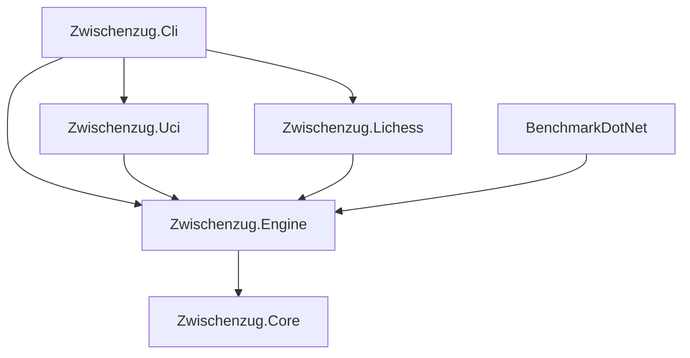

# Architecture

Zwischenzug is a single-threaded chess engine with independent UCI and Lichess adapters. The CLI is the composition root. All projects target .NET 10/C# 14, invariant globalization and nullable reference types; warnings are errors.

## Dependency flow

Adapters reference Engine only; Core types are available through the transitive project reference. No adapter references another adapter. Test projects reference their subject only. Core has no package dependencies.

## State ownership

- **Core**: packed moves, mailbox/bitboards, legal generation, FEN, normalized repetition keys, fixed undo/history storage and perft.
- **Engine**: tapered evaluation, legal static exchange evaluation, four-way TT and deterministic iterative PVS search. The facade owns the position and rejects mutations during search. Search runs on a dedicated long-running worker.
- **UCI**: pure typed parser, invariant formatter, atomic output, asynchronous search completion. Command mutations cancel and await the old search first; ready remains responsive. Stdout contains protocol lines only. Fatal search faults wake input and terminate visibly rather than inventing a move.
- **Lichess transport**: typed HttpClient, per-request bearer header, generated JSON metadata, streaming NDJSON and bounded reconnect. Bodies and headers never enter logs; redirects are disabled by the composition root.
- **Lichess bot**: accepted-challenge reservations plus bounded per-game sessions. Each game owns its engine. Snapshots retain initial FEN and identity; every actionable state rebuilds position from the complete authoritative move prefix. Superseded searches are canceled/awaited before a new position is installed. Ambiguous move delivery refreshes the snapshot before any retry.
- **CLI**: Host configuration, DI, stderr logging and System.CommandLine commands. Manual typed configuration avoids reflection-based options binding. Tokens come from configuration/environment/user-secrets, never command arguments.

Challenge IDs become game IDs in Lichess: [Challenge.gameId](https://github.com/lichess-org/lila/blob/master/modules/challenge/src/main/Challenge.scala) converts the challenge ID and [ChallengeJoiner](https://github.com/lichess-org/lila/blob/master/modules/challenge/src/main/ChallengeJoiner.scala) creates the game with it. Reservations are released by exact identity, never by arbitrary insertion order. Event models support both documented gameId and id fields.

## Verification and measurement

MSTest runs on Microsoft.Testing.Platform. Core coverage uses the six CPW perft positions, state/key restoration and special moves. Engine coverage includes twenty exact mate-distance positions, draws, bounded time/nodes, deterministic repeated searches, TT replacement and SEE pins. Adapter coverage exercises transcript responsiveness and representative NDJSON through fake HTTP streams, including dropped connections, 429 and ambiguous move reconciliation.

The CLI benchmark clears state per position over a committed 25-position suite. Its default-depth node count is a behavioral regression signature, not a strength rating. BenchmarkDotNet reports move-generation throughput, perft/search NPS, allocations and measured TT hit percentage. A ten-game external match checks protocol safety; separate SPRT runs test strength changes.

## Limits and decisions

Position supports 1,024 accumulated plies; search supports 94. Threads is accepted but ignored; pondering, Chess960, books, tablebases and NNUE are out of scope. IEvaluator is the replacement seam for future evaluation implementations. Fixed TT layout and the static Attacks facade isolate future SMP and sliding-attack changes.

See [ADR 0001](adr/0001-position-and-move-representation.md), [ADR 0002](adr/0002-search-and-pruning-strategy.md), [ADR 0003](adr/0003-evaluation-architecture.md) and [ADR 0004](adr/0004-packaging-and-verification-boundaries.md). Detailed observed evidence and unrun checks live in [the implementation ledger](implementation-ledger.md).
